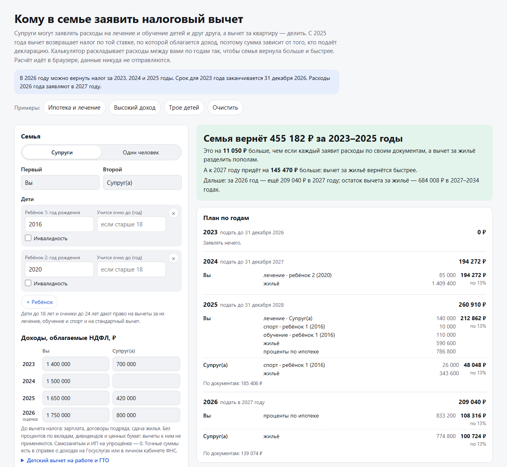

# Кому в семье заявить налоговый вычет

[](https://github.com/kireev-duty/semeynye-vychety/actions/workflows/tests.yml)
[](LICENSE)

**[Открыть калькулятор →](https://kireev-duty.github.io/semeynye-vychety/)**

Супруги могут заявлять расходы на лечение и обучение детей и друг друга, а вычет за квартиру — делить между собой. С 2025 года НДФЛ прогрессивный, а вычет возвращает налог по той ставке, по которой облагается доход: вычет за квартиру на 2 млн при ставке 22% вернёт 440 000 ₽, а не 260 000 ₽. Социальные вычеты на следующий год не переносятся, остаток вычета за жильё переносится. Поэтому от того, кто из супругов и за какой год заявляет расходы, зависят и сумма возврата, и то, как быстро придут деньги.

Калькулятор раскладывает расходы семьи между супругами по годам так, чтобы вернуть больше, а при равной сумме — раньше. Результат он сравнивает с подачей «как в документах».



## Что умеет

- **План по годам**: кто что заявляет за каждый год, который ещё можно вернуть (в 2026 году — 2023–2025), и за текущий год. Указаны сумма вычета, ставка и сумма к возврату.
- **Учитывает прогрессивную шкалу**: расходы уходят тому, у кого выше ставка, или тому, чей доход не занят вычетом за жильё.
- **Делит вычет за жильё**: сколько основного вычета указать каждому супругу в заявлении о распределении и как делить проценты по ипотеке каждый год. Показывает прогноз, когда вернётся остаток.
- **Предупреждает, что сгорит**: суммы сверх лимитов, расходы, на которые не хватает налога, и расходы, которые нельзя заявить (например, спорт супруга).
- **Находит забытые вычеты**: стандартный вычет на детей, если работодатель его не давал, и вычет за ГТО.
- **Проверяет семейную налоговую выплату** для семей с двумя и более детьми: условие по доходу и сумму для каждого родителя.
- **Список документов** для каждого супруга.
- **Ссылка с данными и печать в PDF**, готовые примеры.

Калькулятор — один HTML-файл без внешних библиотек. Он работает в браузере на компьютере и телефоне, в том числе без интернета. Введённые данные никуда не отправляются.

## Какие правила заложены

| Правило | Значение |
| --- | --- |
| Шкала НДФЛ (основная база) | до 2024 года: 13% до 5 млн ₽, 15% сверху; с 2025: 13 / 15 / 18 / 20 / 22% с порогами 2,4 / 5 / 20 / 50 млн ₽ |
| Как вычет возвращает налог | уменьшает доход сверху, то есть по самой высокой ставке человека |
| Общий лимит соцвычетов на человека | 120 000 ₽ до 2023 года, 150 000 ₽ с 2024 года: лечение, своё обучение, обучение супруга, братьев и сестёр, спорт |
| Обучение ребёнка | 50 000 ₽ до 2023 года, 110 000 ₽ с 2024 года на каждого ребёнка, на обоих родителей вместе |
| Дорогостоящее лечение | без лимита |
| За кого можно заявить | лечение: себя, супруга, детей до 18 лет (очников до 24), своих родителей; обучение: себя, детей, братьев и сестёр (очно до 24), супруга (очно, с 2024 года); спорт: себя, детей, с 2026 года — родителей-пенсионеров |
| Расходы супруга | любой из супругов может заявить расходы на лечение и обучение второго супруга и детей, независимо от того, на кого оформлены документы |
| Перенос на другой год | социальные вычеты не переносятся, остаток вычета за жильё переносится |
| Основной вычет за жильё | до 2 млн ₽ на человека; распределение между супругами — один раз |
| Вычет по процентам | до 3 млн ₽ на человека один раз в жизни; долю супругов можно менять каждый год |
| Взносы на ИИС и ПДС | до 400 000 ₽ в год, только по своему счёту |
| Стандартный вычет на детей | до 2024 года: 1 400 / 1 400 / 3 000 ₽ в месяц при доходе до 350 000 ₽; с 2025: 1 400 / 2 800 / 6 000 ₽ при доходе до 450 000 ₽; на ребёнка-инвалида ещё 12 000 ₽ |
| Вычет за ГТО | 18 000 ₽ в год с 2025 года при знаке ГТО и диспансеризации |
| За какие годы можно вернуть | за три года до текущего |
| Семейная выплата | налог без вычетов минус 6% дохода, каждому работающему родителю; двое и больше детей до 18 лет (очники до 23); доход на человека не выше 1,5 прожиточного минимума региона; заявление с 1 июня по 1 октября |

**Источники:** Налоговый кодекс РФ (ст. 210, 218, 219, 219.2, 220, 224, 78); Федеральный закон от 12.07.2024 № 176-ФЗ (прогрессивная шкала, детские вычеты, ГТО); от 28.04.2023 № 159-ФЗ (лимиты соцвычетов с 2024 года); от 31.07.2023 № 389-ФЗ (обучение супруга); от 28.11.2025 № 425-ФЗ (спорт родителей-пенсионеров); [от 13.07.2024 № 179-ФЗ](https://rg.ru/documents/2024/07/17/document-semejnaya-vyplata.html) (семейная выплата); [ФНС о лимитах соцвычетов с 2024 года](https://www.nalog.gov.ru/rn60/news/activities_fts/13600227/); [ФНС о детских вычетах с 2025 года](https://www.nalog.gov.ru/rn72/news/tax_doc_news/16170847/); [ФНС о вычете за спорт](https://www.nalog.gov.ru/rn03/news/activities_fts/16251943/); письма Минфина о распределении социальных вычетов между супругами.

## Как ищется лучший план

Калькулятор проходит по годам. В каждом году он сначала записывает расходы, которые может заявить только один человек, затем решает, как распределить остальные. После этого применяет вычет за жильё: в пределах дохода этого года, а остаток переносит дальше. Перебираются доля основного вычета за жильё (шаг 2,5% с уточнением), доля процентов по ипотеке и стратегия распределения соцвычетов в каждом году. Соцвычеты раскладываются по убыванию ставки с точностью до рубля. Лучшим считается план с наибольшей суммой возврата, при равной сумме — тот, где деньги приходят раньше.

Тесты сравнивают этот поиск с полным перебором на 150 случайных семьях: найденный план ни разу не хуже перебора.

## Допущения модели

- Доход считается равномерным по месяцам: это важно только для детского вычета, который действует до месяца, когда доход превысит лимит.
- Возраст детей определяется по году рождения, без точных дат.
- Учитываются доходы основной налоговой базы: зарплата, договоры, аренда. Вклады, дивиденды и ценные бумаги не учитываются: к ним социальные и имущественные вычеты не применяются.
- Не учитываются вычеты, уже полученные у работодателя в течение года, благотворительность, вычеты при продаже имущества, перенос вычета пенсионерами на прошлые годы, двойной детский вычет единственному родителю.
- Жильё — одно. Считается, что оно куплено в браке.
- Для прогноза после текущего года доход растёт на заданный процент, а проценты по ипотеке — указанная сумма в год.
- Семейная выплата проверяется только по доходу и числу детей. Имущество, долги по алиментам и другие условия нужно проверить самостоятельно.

Расчёт ориентировочный и не заменяет консультацию налогового специалиста. Правила актуальны на октябрь 2026 года.

## Как запустить у себя

Скачайте `index.html` и откройте его в браузере. Больше ничего не нужно.

Чтобы выложить свою копию в интернет, сделайте форк репозитория и включите GitHub Pages: Settings → Pages → Branch: `main`, папка `/ (root)`.

## Как обновить правила

Все правила, которые меняются по годам, лежат в функции `rules(year)` в `index.html` внутри `<script id="core">`. Расчётное ядро — чистые функции без доступа к странице, поэтому его удобно проверять тестами:

```bash
node tests.mjs
```

Нужен Node.js 18 или новее. Тесты проверяют шкалы, лимиты по годам, право на вычет за разных родственников, детский вычет, перенос вычета за жильё, лимит процентов, семейную выплату и логику распределения между супругами. Они запускаются автоматически при каждом изменении в репозитории.

Нашли ошибку в расчёте или устаревшее правило? [Создайте issue](https://github.com/kireev-duty/semeynye-vychety/issues).

## Лицензия

[MIT](LICENSE) — можно свободно использовать, менять и распространять.
